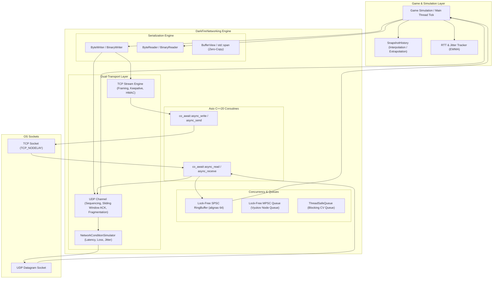

# DarkFireNetworking

[](https://en.cppreference.com/w/cpp/20)
[](https://opensource.org/licenses/MIT)
[](https://cmake.org)

A modern, zero-copy, dual-transport (TCP + UDP) real-time multiplayer networking framework for C++20.

Originally based on the OneLoneCoder/javidx9 Asio networking tutorial architecture, this project is a complete rewrite engineered for production game networking: replacing callback chains with **C++20 coroutines**, providing **forward FIFO zero-copy binary serialization**, a **sequenced and reliable UDP transport** with sliding-window ACKs and MTU fragmentation, **HMAC-SHA256 handshake authentication**, **lock-free ring buffers**, and **game networking primitives** (EWMA RTT tracking, snapshot interpolation, network simulator).

---

## Architecture



---

## Architectural Comparison

| Feature | Legacy DarkFire (javidx9) | DarkFire 2.0 |
| :--- | :--- | :--- |
| **Language Standard** | C++11 / C++14 | **C++20** |
| **Serialization Order** | LIFO inverted (pops backwards from tail) | **FIFO forward** (what is written first is read first) |
| **Bounds Safety** | None (`size - sizeof` underflows `size_t`) | **Strict bounds checking**, returns `NetResult<T>` on error |
| **Endianness** | Host `memcpy` (breaks across architectures) | **Network Byte Order (Big-Endian)** via `<bit>` `std::endian` & `std::byteswap` |
| **Supported Types** | POD primitives only | Scalars, concept-constrained Enums, strings, vectors, trivially copyable structs |
| **Zero-Copy Support** | None (`std::vector` reallocations per push) | `std::span<const uint8_t>` and `BufferView` zero-copy slices |
| **Async Model** | Nested lambdas with raw pointer captures | **C++20 coroutines (`asio::awaitable<void>`, `co_await`)** |
| **Transport** | TCP only (subject to Head-of-Line blocking) | **Dual-Transport (TCP + Fast Sequenced UDP + Reliable UDP)** |
| **UDP Fragmentation** | Not available | **MTU fragmentation and reassembly** (payloads up to 64 KB sliced into $\le 1200$ B chunks) |
| **UDP Reliability** | Not available | **Sliding 32-bit ACK history bitfield** with selective retransmission |
| **Authentication** | Basic arithmetic integer scramble | **HMAC-SHA256 challenge-response**, CRC32 integrity checks, magic byte framing |
| **Queues** | Mutex + CV `net_tsqueue` contention | **Cache-line aligned SPSC ring buffer**, **lock-free MPSC node queue** |
| **Game Utilities** | None | **EWMA RTT & jitter tracking**, **circular snapshot interpolation**, **network simulator** |
| **Diagnostics** | Direct `std::cout` prints | **Pluggable leveled logger (`Trace`, `Debug`, `Info`, `Warning`, `Error`)** |
| **Build System** | Visual Studio `.vcxproj` only | Target-based **CMake 3.20+** and **Premake5** |

---

## Wire Protocol Specification

All multi-byte fields are transmitted in **Network Byte Order (Big-Endian)**.

### TCP Packet Format
```
+----------------+---------------+---------------+-------------------+------------------+-------------------+--------------------+
| Magic (2B)     | Version (1B)  | Flags (1B)    | Message ID (2B)   | Body Size (4B)   | Checksum (4B)     | Payload (N Bytes)  |
| 0xDF4E         | 0x02          | Bitfield      | uint16_t          | uint32_t         | CRC32             | Raw serialized data|
+----------------+---------------+---------------+-------------------+------------------+-------------------+--------------------+
```
- Total header size: **14 bytes**.
- Checksum: IEEE 802.3 CRC32 computed over the payload bytes.
- Packets with invalid magic bytes or checksum mismatch are rejected before body processing.

### UDP Packet Format
```
+------------+-----------+----------+---------------+----------------+------------+------------------+-----------------+------------------+----------------+---------------+--------------------+
| Magic (2B) | Ver (1B)  | Flg (1B) | Msg ID (2B)   | Seq ID (4B)    | ACK ID (4B)| ACK Bitmask (4B) | Frag Idx (2B)   | Frag Count (2B)  | Body Size (4B) | Checksum (4B) | Payload (N Bytes)  |
| 0xDF55     | 0x02      | Bitfield | uint16_t      | uint32_t       | uint32_t   | uint32_t         | uint16_t        | uint16_t         | uint32_t       | CRC32         | Datagram chunk     |
+------------+-----------+----------+---------------+----------------+------------+------------------+-----------------+------------------+----------------+---------------+--------------------+
```
- Total header size: **30 bytes**.
- `Seq ID`: Monotonically increasing sequence number per peer (handles 32-bit wrap-around).
- `ACK ID` & `ACK Bitmask`: Acknowledges the latest received sequence and the preceding 32 packets.
- `Frag Idx` & `Frag Count`: Automatic slicing for payloads exceeding `STANDARD_MTU` (1200 bytes).

---

## Integration

### CMake (`FetchContent` or `add_subdirectory`)

DarkFireNetworking is structured as a modern CMake interface library:

```cmake
# Option A: Submodule / subfolder
add_subdirectory(CPP-Networking-Framework)
target_link_libraries(MyGameEngine PRIVATE darkfire_net)

# Option B: FetchContent
include(FetchContent)
FetchContent_Declare(
    darkfire_net
    GIT_REPOSITORY https://github.com/DarkFire-Enterprise/CPP-Networking-Framework.git
    GIT_TAG        main
)
FetchContent_MakeAvailable(darkfire_net)
target_link_libraries(MyGameEngine PRIVATE darkfire_net)
```

Target requirements:
- C++ standard: `cxx_std_20`
- Threading: `Threads::Threads`
- Windows socket libraries: `ws2_32`, `mswsock` (linked automatically on Windows)

---

## Quick Start

### 1. Binary Serialization (`ByteWriter` & `ByteReader`)

Streams read and write strictly in FIFO order, convert integers and floats to network byte order, and perform bounds checks on every read.

```cpp
#include <darkfire/darkfire.hpp>

enum class WeaponType : uint16_t { Rifle = 1, Rocket = 2 };

struct Transform {
    float x, y, z;
};
// Opt-in for zero-overhead memcpy serialization:
DARKFIRE_DECLARE_TRIVIALLY_SERIALIZABLE(Transform);

// Serialize
darkfire::net::ByteWriter writer;
writer << uint32_t(101) 
       << std::string("PlayerOne") 
       << WeaponType::Rifle 
       << Transform{ 10.0f, 20.0f, 30.0f };

// Deserialize
darkfire::net::ByteReader reader(writer.Span());
uint32_t id;
std::string name;
WeaponType weapon;
Transform pos;

reader >> id >> name >> weapon >> pos;

if (reader.IsOk()) {
    // Data successfully parsed
}
```

### 2. Dual-Transport Client & Server (TCP + UDP)

Use **TCP** for reliable handshakes, matchmaking, and chat. Use **UDP** for high-frequency position updates and input replication.

```cpp
#include <darkfire/darkfire.hpp>

enum class GameMsg : uint16_t {
    LoginRequest  = 1,
    LoginResponse = 2,
    PlayerInput   = 3,
    StateSnapshot = 4
};

// Server Implementation
class GameServer : public darkfire::net::DualServer<GameMsg> {
public:
    GameServer() : darkfire::net::DualServer<GameMsg>(60000 /*TCP*/, 60001 /*UDP*/) {}

protected:
    void OnMessage(std::shared_ptr<darkfire::net::TCPConnection> client, darkfire::net::Packet& packet) override {
        // Reliable TCP message
        if (packet.GetIdAs<GameMsg>() == GameMsg::LoginRequest) {
            darkfire::net::Packet response(GameMsg::LoginResponse);
            response << client->GetId();
            Send(client, response);
        }
    }

    void OnUDPMessage(const asio::ip::udp::endpoint& sender, darkfire::net::Packet& packet) override {
        // Fast UDP message (sequenced or reliable)
        if (packet.GetIdAs<GameMsg>() == GameMsg::PlayerInput) {
            // Process player input datagram
        }
    }
};

// In your game loop:
GameServer server;
server.StartDual();

while (gameRunning) {
    // Process incoming network messages on the main simulation thread
    server.UpdateDual();
    SimulateWorld();
}
```

### 3. Entity Snapshot Interpolation (`SnapshotHistory`)

Smooth remote player transforms across variable packet arrival times:

```cpp
darkfire::net::game::SnapshotHistory<Transform, 64> history;

// On UDP snapshot packet arrival:
history.AddSnapshot(packetTimestampMicros, incomingTransform);

// On render frame:
uint64_t renderTime = darkfire::net::game::RTTTracker::GetCurrentTimeMicros() - 100'000; // 100ms interp delay

auto smoothed = history.Sample(renderTime, [](const Transform& a, const Transform& b, double t) {
    return Transform{
        a.x + (b.x - a.x) * static_cast<float>(t),
        a.y + (b.y - a.y) * static_cast<float>(t),
        a.z + (b.z - a.z) * static_cast<float>(t)
    };
});

if (smoothed) {
    entity.SetPosition(smoothed->x, smoothed->y, smoothed->z);
}
```

### 4. Network Condition Simulator

Test multiplayer replication locally under realistic latency, jitter, and packet loss:

```cpp
darkfire::net::game::NetworkSimulator sim;
sim.SetLatency(60, 100); // 60-100 ms latency
sim.SetPacketLoss(0.05);  // 5% random packet drop

sim.Enqueue(packet);

// In simulation tick:
for (auto& readyPacket : sim.PollReady()) {
    ProcessPacket(readyPacket);
}
```

---

## Building and Running Tests

### Requirements
- Compiler: MSVC 2022+ / Clang 14+ / GCC 11+ (C++20 support required)
- Build system: CMake 3.20+ or Premake5
- Standalone Asio 1.28+ (bundled under `Libs/asio-1.28.1`)

### Build Commands
```bash
# Configure
cmake -B build -G "Visual Studio 18 2026" -A x64

# Compile Release binaries
cmake --build build --config Release

# Run Unit & Integration Tests
ctest --test-dir build -C Release --output-on-failure
```

### Example Applications

1. **EchoBench** (`examples/EchoBench`):
   Stress benchmark verifying throughput and latency under high volume.
   ```bash
   .\build\examples\Release\EchoBench.exe
   ```
   *Performance*: Over 30,000 packets/sec on loopback with sub-millisecond round-trip times.

2. **ChatRoom** (`examples/ChatRoom`):
   Multi-client TCP broadcast room with handles and room IDs.
   ```bash
   .\build\examples\Release\ChatServer.exe 60020
   .\build\examples\Release\ChatClient.exe 127.0.0.1 60020
   ```

3. **SpatialReplication** (`examples/SpatialReplication`):
   Authoritative 60 Hz physics server replicating 2D/3D entity transforms over 20 Hz UDP snapshots with client-side interpolation.
   ```bash
   .\build\examples\Release\SpatialServer.exe
   .\build\examples\Release\SpatialClient.exe
   ```

---

## License

This project is licensed under the MIT License. See [LICENSE](LICENSE) for details.
